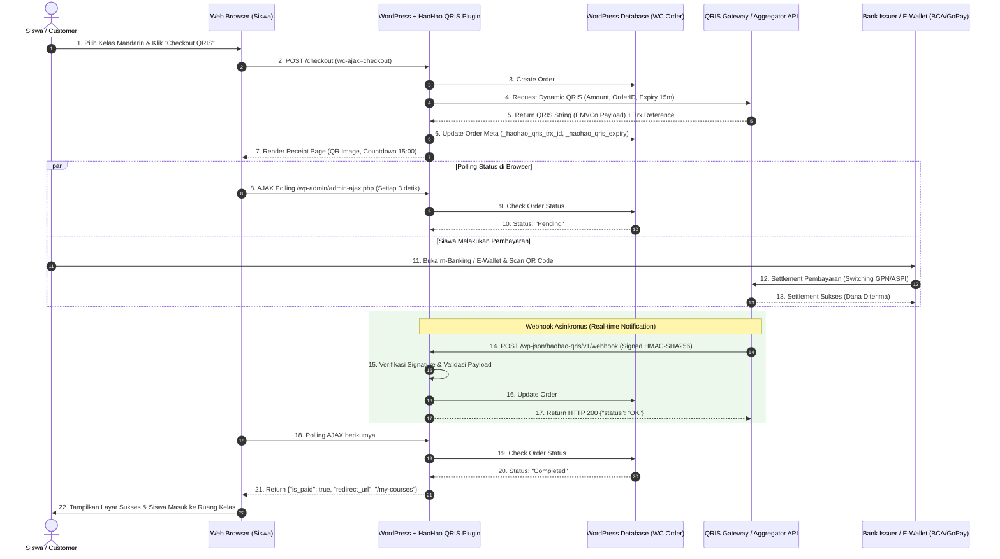

# 📑 Dokumentasi Arsitektur & Alur Pembayaran QRIS
### Proyek: HaoHao Mandarin Course Platform & WooCommerce Payment Gateway
**Penyusun:** Ahmad Yusuf Arifin  
**Versi:** 1.2.0  
**Standar:** Bank Indonesia (PADG No. 21/18/PADG/2019) & EMVCo QR Code Specification

---

## 1. Ringkasan Eksekutif (*Executive Summary*)

Dokumen ini menguraikan spesifikasi teknis dan alur integrasi pembayaran **QRIS (Quick Response Code Indonesian Standard)** dinamis untuk platform edukasi **HaoHao Mandarin** berbasis WordPress & WooCommerce.

Sistem ini memungkinkan siswa kursus melakukan pembayaran secara instan menggunakan seluruh aplikasi perbankan m-Banking (BCA, Mandiri, BRI, BNI, CIMB) maupun dompet digital / e-wallet (GoPay, OVO, ShopeePay, DANA, LinkAja) dengan verifikasi otomatis kurang dari 10 detik tanpa perlu konfirmasi manual.

---

## 2. Diagram Alur Transaksi (*Sequence Diagram*)

Alur komunikasi antar aktor (Siswa, Browser, WordPress WooCommerce, QRIS Engine, dan Switching Perbankan) digambarkan sebagai berikut:



---

## 3. Spesifikasi Payload QRIS (Standar EMVCo ASPI)

Setiap kode QRIS yang dihasilkan adalah **QRIS Dinamis** (*Dynamic QRIS*), yang memuat ID transaksi unik dan nominal tagihan terkunci sehingga siswa tidak dapat mengubah jumlah pembayaran.

Struktur Tag-Length-Value (TLV):
| Tag | Keterangan | Nilai Contoh | Penjelasan |
| :--- | :--- | :--- | :--- |
| `00` | Format Indicator | `01` | EMVCo Version 1.0 |
| `01` | Point of Initiation | `12` | 12 = Dynamic QR Code (Nominal terkunci) |
| `26` | Merchant Account Info | `ID.CO.QRIS.WWW...` | National Merchant Identifier (NMID) |
| `52` | Merchant Category Code (MCC)| `8211` | Sekolah / Lembaga Pendidikan (Courses) |
| `53` | Transaction Currency | `360` | Kode ISO Rupiah (IDR) |
| `54` | Transaction Amount | `650000` | Nominal tagihan kursus |
| `58` | Country Code | `ID` | Indonesia |
| `59` | Merchant Name | `HAOHAO MANDARIN` | Nama merchant terverifikasi |
| `60` | Merchant City | `JAKARTA` | Lokasi domisili usaha |
| `62` | Additional Data (Reference) | `QRIS-108-17000` | ID Unik Order WooCommerce |
| `63` | Checksum (CRC16-CCITT) | `ABCD` | 4 digit verifikasi integritas string |

---

## 4. Keamanan & Verifikasi Webhook (*Signature Validation*)

Untuk mencegah manipulasi notifikasi (*replay attacks* atau notifikasi palsu), setiap *webhook callback* dilindungi dengan **HMAC-SHA256 digital signature**:

### Header HTTP:
```http
POST /wp-json/haohao-qris/v1/webhook HTTP/1.1
Host: haohaomandarin.com
Content-Type: application/json
X-HaoHao-Signature: a6f8c7b41e3d920fa58b87e221321456a0c451db68265a7742129e92f15598ba
```

### Format Payload JSON:
```json
{
  "order_id": 108,
  "transaction_id": "QRIS-108-1700018920",
  "gross_amount": 650000.00,
  "currency": "IDR",
  "issuer": "BCA Mobile",
  "transaction_status": "SUCCESS",
  "settlement_time": "2026-11-08 17:35:10",
  "reference_no": "REF-NMID-99281726"
}
```

### Logika Verifikasi PHP:
```php
$expected_signature = hash_hmac('sha256', $raw_request_body, $secret_server_key);
if (!hash_equals($expected_signature, $incoming_signature)) {
    // Tolak request jika signature tidak cocok
    return new WP_REST_Response(array('error' => 'Unauthorized Signature'), 401);
}
```

---

## 5. Idempotensi & Penanganan Skenario Gagal (*Edge Cases*)

1. **Notifikasi Ganda (*Duplicate Callbacks*):**
   * Sebelum merubah status order, sistem memeriksa apakah order sudah berstatus `completed` atau `processing`. Jika sudah, sistem langsung merespons `HTTP 200 OK` tanpa memicu ulang pengiriman email atau pengurangan stok.
2. **Kedaluwarsa (*Timeout / Expiry*):**
   * QRIS memiliki masa berlaku 15 menit. Jika siswa tidak membayar dalam kurun waktu tersebut, order otomatis ditandai `cancelled` dan stok dikembalikan.
3. **Pembayaran Parsial / Kurang:**
   * Tidak dimungkinkan karena QRIS Dinamis telah mengunci nominal pesanan langsung ke nominal eksak dari sistem WooCommerce.

---

**© 2026 HaoHao Mandarin Project &bull; Dikembangkan oleh Ahmad Yusuf Arifin**
